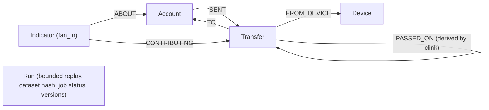

# streaming-alert-case

An evidence-backed investigation of a streaming fraud alert. clink derives
event-time indicators from out-of-order transfers and writes them, linked to
the events behind them, into one Relate file. An agent investigates through
Relate, and a deterministic checker tests every structured claim it makes
against the graph and against the original events.

## Use case

A fraud analyst is handed two fan-in alerts. In each, an account received
transfers from six distinct senders inside one hour and passed money on
within 30 minutes. As indicators the two alerts fire on the same rules. The
analyst needs to know which one deserves attention, and to trace every
statement back to the transfers behind it.

The relationships answer it, and the alert rows do not. From one account the
money moves three onward links to a fourth account, and one device was used to
send from three accounts along the way. From the other it moves one link and
stops, and no device is shared.

The data is synthetic: 55 transfers, generated from a fixed seed and written in
arrival order, with two deliberate inversions. Every conclusion here is about
this bounded replay only, as processed by the run the store records. A
recorded relationship is not proof of fraud, ownership, identity or causation.

## Why it takes both clink and Relate

clink keeps the evidence right when events arrive out of order. It processes
the transfers by event time, with five minutes allowed for lateness. Taken in
arrival order instead, this dataset gives two wrong answers:

- T0012 arrives after an event from the next hour. A window with no allowance
  for late events has closed by then, and the alert reads five senders and
  2,810.00 instead of six and 3,570.00.
- T0008, a debit, arrives before T0007, the credit it passes on. A lookup made
  as events arrive misses the onward link `onward:T0007:T0008`, and reports
  A-5092 as a resting point when the money moved on.

`verify.py` checks both, and the checker rejects both wrong answers when they
are stated as claims (`claims/planted.json`, P2 and P3).

Relate holds the connections and answers questions over them in Cypher: how
far the money went, where it came to rest, and which accounts on the way
sent from the same device. The comparison below puts the same records in
tables, to measure what the graph changes for an investigating agent.

## How it uses Relate

- **Mode:** single file, `store/case.rl` (81,920 bytes).
- **Why this mode:** the whole case is one file that ships in this repository.
  You can open, copy and inspect it with nothing else running. Three clink
  jobs write it at once through one in-process handle. The verifier, the
  explorer and the agent each reopen it read-only, in another process.
- **What the graph models:** accounts, transfers, devices, the indicators clink
  derived, and the run that wrote it.



Relate capabilities used:

- **Embedded writes from clink:** clink's `connector='relate'` links Relate's C
  library. Each of the three SQL jobs in `pipeline/case.sql` writes its rows
  with a Cypher statement that MERGEs by stable ids under uniqueness
  constraints, one transaction per batch.
- **Transactions shared by concurrent writers:** the three jobs write some of
  the same nodes at once. Relate refuses the later conflicting transaction at
  commit, and the sink rolls back and retries it.
- **Read-only reopening from Python:** `relate-db` 1.0.1 opens the published
  store read-only for the verifier, the explorer and the agent's query tool.
  Writes are refused there.
- **Variable-length traversal:** the onward routes, resting points and shared
  devices come from Cypher path queries (`alertcase/graph.py`).

Not used: the `relate` command line, Relate's MCP server, WebAssembly, Bolt,
HTTP and vector search.

## Setup and run

Needs Python 3.11 or later. Rebuilding the store also needs Docker, and a
live agent run needs Anthropic API credentials. Nothing else needs them.

```bash
git clone <this repository> streaming-alert-case && cd streaming-alert-case
python3 -m venv .venv
.venv/bin/pip install --require-hashes -r requirements.txt

.venv/bin/python verify.py          # store, checker, tables and recorded runs; no model, no API key
.venv/bin/python explore.py         # the investigation, read from the store
.venv/bin/python -m unittest        # the checker and the agent harness
```

Explore the store yourself, read-only:

```bash
.venv/bin/python explore.py --cypher "MATCH p = (:Transfer {id: 'T0002'})-[:PASSED_ON*]->(t:Transfer) RETURN [n IN nodes(p) | n.id] AS route"
.venv/bin/python explore.py --sql "SELECT * FROM fan_in_alerts"
```

Rebuild the store from the event file. This runs clink's three jobs from the
runtime image, publishes only if every job succeeded, and then verifies:

```bash
./rebuild.sh
```

Optional, with credentials (`ANTHROPIC_API_KEY`, or an `ant auth login` profile):

```bash
.venv/bin/python investigate.py              # one live agent run, written to runs/live/
.venv/bin/python compare.py --runs 3         # the table and graph comparison, live
```

## Where the data lives

| Path | What |
|---|---|
| `store/case.rl` | The Relate store: one file, written by clink, published by `scripts/publish_run.py` |
| `data/events.ndjson` | The 55 transfers in arrival order: what clink reads |
| `data/scenario.json` | The designed facts, read by the verifier only |
| `tables/case.sqlite` | The same records as tables, for the comparison only |
| `claims/planted.json` | Deliberately unsupported claims the checker must reject |
| `runs/recorded/` | Recorded agent runs, each with its transcript, output, verdicts and score |

## The pipeline

`pipeline/case.sql` declares the event file as a table with event time and a
five-minute watermark lag, and runs three jobs into the same store:

1. every transfer, with its sender, receiver and device;
2. fan-in: at least five distinct senders into one account inside a one-hour
   event-time window, written as an Indicator linked to each contributing
   transfer;
3. onward transfer: an event-time interval join of a credit to an account with
   a debit from that account up to 30 minutes later, written as a
   `PASSED_ON` relationship between the two transfers.

`rebuild.sh` publishes the store only when clink exited 0 without being
cancelled. clink's embedded runner returns 0 only when every job reached
completion and none reported an error. `scripts/publish_run.py` then checks
that the store's transfers equal the file, record for record. Only after that
does it write the Run record, with the dataset's hash, the pipeline's hash, the
jobs completed, the image and the versions. The conclusions are relative to
that run and that file. The replay is bounded, and nothing here claims a
completeness frontier for a live stream.

## What the investigation shows

`explore.py` reads this from the store:

```text
                                 A-9278               A-9895               from
  distinct senders in one hour   6                    6                    fan-in indicator
  transfers in the window        6                    6                    fan-in indicator
  total received                 3,570.00             150.00               fan-in indicator
  passed on within 30 minutes    yes                  yes                  onward-transfer indicator
  onward links, at most          3                    1                    relationships, read from Relate
  came to rest at                A-4989               A-1415               relationships, read from Relate
  accounts on the routes         4                    2                    relationships, read from Relate
  device shared on the routes    D-568 (3 accounts)   none                 relationships, read from Relate
```

Each value traces to stable references: `fan_in:A-9278:1794301200000` and its
contributing transfers T0002, T0003, T0006, T0010, T0011 and T0012, the routes
`path:T0002>T0007>T0008>T0009` and `path:T0010>T0014>T0015>T0016`, and the
links that make them up, such as `onward:T0007:T0008`.

## The case note and its checker

The agent writes its case note as structured output: findings, hypotheses and
unresolved questions, kept apart, and a list of claims. Every finding cites
claim ids. Every claim is one of seven types, each with one rule
(`alertcase/claims.py`):

| Type | Asserts |
|---|---|
| `event` | a transfer exists with the stated sender, receiver, amount, time and device |
| `indicator` | a fan-in indicator has the stated values and exactly the stated contributing transfers |
| `onward_path` | each step is a recorded onward link, and the path starts at an alert and comes to rest where stated |
| `onward_reach` | an alert's longest chain, resting accounts and route accounts |
| `shared_device` | a device sent from exactly the stated accounts on an alert's routes |
| `absence` | no shared device on a route, no onward link from a transfer, no alert for an account |
| `count` | the number of alerts, transfers, onward links, accounts or devices |

The checker applies each rule twice: to the facts derived from the original
event file by the independent reference rules (`alertcase/reference.py`),
and to the facts read from the graph. A claim is supported only when both
agree. It is unsupported when neither does, and inconsistent when the two
disagree, which happens with a damaged store or a changed file. The checker
needs no model. It validates references and structured values, and it does
not validate prose. A finding is only as good as the claims it cites, and the
case note shows the checker's verdict beside each claim.

`claims/planted.json` holds four claims that must be rejected, and
`verify.py` checks that they are. Two of them are what arrival-order
processing would have concluded:

```text
PASS  planted P2 rejected   unsupported: senders is 6, not 5; ...; contributing transfers differ: missing ['T0012']
PASS  planted P3 rejected   unsupported: T0007 was passed on: ['onward:T0007:T0008']
```

## Recorded and live agent runs

The agent is Claude (`claude-opus-5-5`, effort `high`) with one read-only
query tool, run through the Anthropic SDK's tool-use loop
(`alertcase/agent.py`). A recorded run lives in `runs/recorded/<name>/` with
every response, every query and its result, the structured output, the
checker's verdicts, the score and the rendered `case_note.md`. `verify.py`
checks every claim of a recorded run again and fails if the verdicts or
scores differ from the ones recorded. A live run writes `runs/live/`, which
git ignores, and never replaces a recorded one.

**Status: no agent run has been recorded yet.** The harness is tested against
a scripted stand-in client (`tests/test_agent_loop.py`), which checks the loop,
the budgets and the recording. The stand-in is not a model, and nothing it
returns is reported as a result.

## Table-based or Relate-based investigation: the comparison

`compare.py` runs the same agent on the same evidence two ways, alternating
arms. The graph arm queries the Relate store in Cypher. The table arm queries
the same records as SQLite tables, exported from the store, in SQL.
Everything else is the same:

- the model, the effort and the budgets: 20 queries, 30 model requests,
  16,000 tokens per response;
- the system prompt, apart from the paragraph that describes the evidence;
- the task, the tool, the output schema and the checker.

Each run is scored the same way (`alertcase/scoring.py`):

- **correctness:** the share of the seven required facts covered by
  supported claims; the facts are derived from the events, not from a model;
- **unsupported claims:** claims the checker did not support;
- **reference validity:** the share of distinct ids cited anywhere,
  prose included, that exist in the dataset;
- **effort:** queries, failed queries, model requests, tokens and seconds.

**Status: not run yet.** No results are reported until there are recorded
runs to compute them from. `verify.py` recomputes the summary from them.

## What ran

On macOS 26.3.1, arm64, on 13 November 2026:

- `./rebuild.sh` built `store/case.rl` from
  `ghcr.io/orhaugh/clink-runtime:sha-c134524d8674`, index digest
  `sha256:f19c890c747e8a6e097568e0003cd83c303599a4bfbb0095751045909124802f`, as
  linux/arm64. It ran with Docker Desktop (engine 29.8.2) and no network. clink
  exited 0, 55 of 55 records reconciled, and the store was published.
- `verify.py`: 15 of 15 checks passed (9 on the store, 5 on the checker, 1 on
  the tables).
- `python -m unittest`: 11 tests passed.
- Python 3.12.3, `relate-db` 1.0.1, `anthropic` 2.8.0, installed with
  `--require-hashes` from `requirements.txt`.
- A fresh clone, set up exactly as in "Setup and run" with Python 3.11.9:
  `verify.py` 15 of 15, the unit tests passed, `explore.py` ran, and
  `./rebuild.sh` exited 0 and verified 15 of 15 again.

The same pipeline, from the same image, was run on a scratch copy as part of
the spike this repository grew from. Five fresh runs on linux/arm64 and five
on linux/amd64, under emulation on the same Mac, each passed the spike's nine
store checks.

## Not done, and not verified

- No agent run and no comparison have been recorded yet (see above).
- The `relate` command line and Relate's MCP server were not run. The store
  was reopened through the Python library only.
- The pipeline has run only in Docker on a Mac: never on a Linux host or an
  x86_64 machine.
- clink's Relate connector is in no clink release. The image is a build of
  clink's main branch.
- Rebuilt stores are not byte-identical to each other. Every check compares
  content.

## Reused work, tools and disclosures

- **clink** is the author's own stream engine, a project started before this
  contest (its history begins in June 2026; latest release v0.15.0, 3 November
  2026). It is not in this repository. Its Relate connector,
  `connector='relate'`, was written during the contest period. It landed in
  clink's repository on 13 November 2026 in commits b862cd62, b5f0f2c5,
  b2e73a69, 85bdd6a6 and c134524d, and was published in the runtime image this
  repository pins.
- **This repository** was started on 13 November 2026. Its event generator,
  reference rules, store checks and pipeline come from a spike written on
  12 and 13 November 2026, also during the contest period.
- **Relate by Neo4j:** `relate-db` 1.0.1 from PyPI, and Relate's C library
  1.0.1 inside clink's image.
- **Third-party tools:** Docker, to run the clink image. The Anthropic Python
  SDK 2.8.0 and the model `claude-opus-5-5`, for the agent.
- **AI tools:** Claude Code, with Claude Opus 5.5, wrote much of the code and
  documentation in this repository and in clink's Relate connector, under the
  author's direction and review.

## Licence

Apache License 2.0. See [LICENSE](LICENSE) and [NOTICE](NOTICE).
